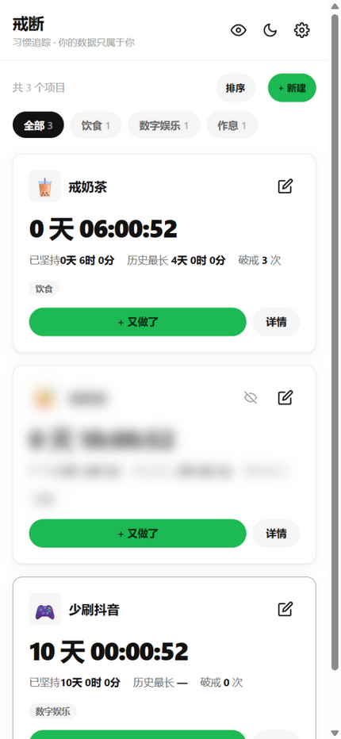
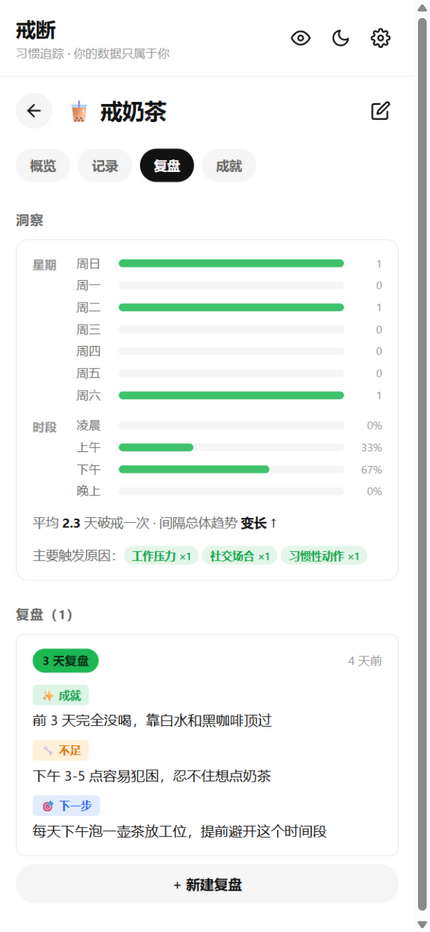
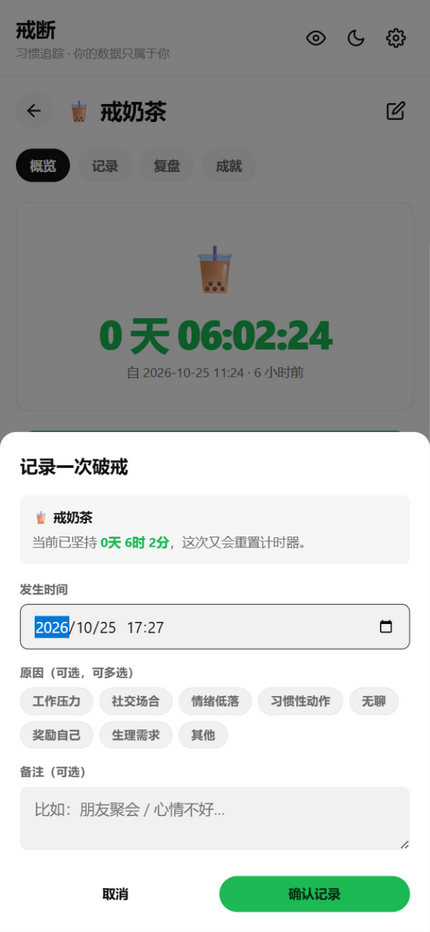
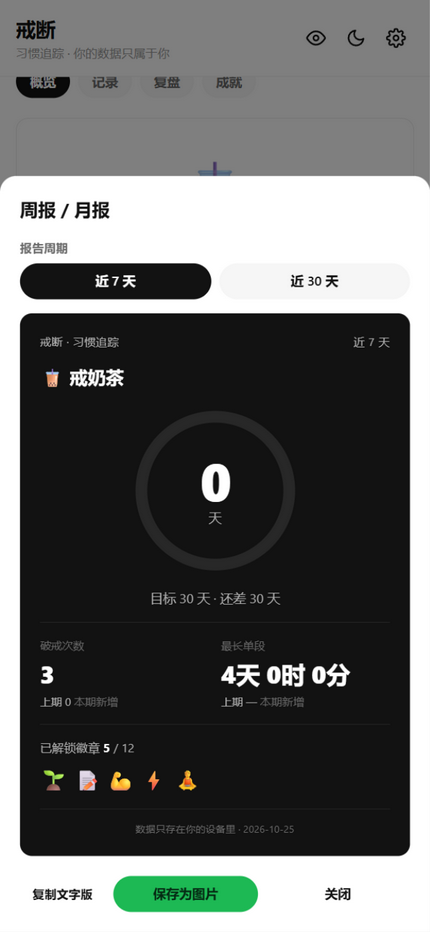
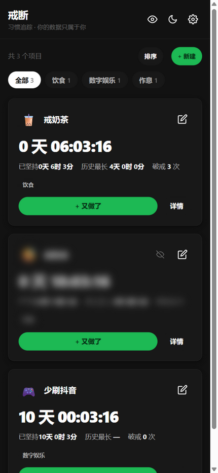

# 戒断 · Quit Tracker

> **把每一次“又做了”都变成数据，让坚持变成可看见的曲线。**

一个轻量化的移动端优先戒断习惯追踪工具。**纯前端、数据完全本地、不登录、不上传**。

> 🌐 **在线使用**：<https://edward8n25.github.io/habit-quit-tracker/>（GitHub Pages；数据仅存本机浏览器，刷新 / 换设备前请导出备份）



---

## 🤔 这些场景你一定经历过

- 戒奶茶第 5 天又喝了？**想看看自己到底坚持了多久**
- 每次“破戒”想记录一下，但记录太麻烦？**点两下就记完**（「+ 又做了」→ 确认，全程不到 5 秒）
- 总是“下次一定”自我原谅？**每天醒来看到“已坚持 X 天”，比鸡汤管用**
- 30 天过去了，想看看自己的“复盘”在哪些地方总踩坑？**模式洞察告诉你周几最容易破戒**
- 换手机 / 清缓存数据没了？**主 key + 备份 key 双写冗余，JSON 损坏自动回退**

---

## 📑 目录

- [✨ 核心亮点](#-核心亮点)
- [🎯 功能特性](#-功能特性)
- [🚀 快速开始](#-快速开始)
- [💾 数据与备份](#-数据与备份)
- [🛠️ 调试入口](#-调试入口)
- [🧰 技术栈](#-技术栈)
- [📂 目录结构](#-目录结构)
- [🗺️ 开发计划](#-开发计划)
- [🛡️ 隐私与安全](#-隐私与安全)
- [🤝 致谢](#-致谢)
- [📜 License](#-license)

---

## ✨ 核心亮点

<table>
  <thead>
    <tr><th width="5%"></th><th width="24%" align="left">能力</th><th width="71%" align="left">说明</th></tr>
  </thead>
  <tbody>
    <tr><td align="center">🔥</td><td><strong>实时计时</strong></td><td>每秒刷新“已坚持 X 天”——不需要打开 App 自我评估，打开就能看到</td></tr>
    <tr><td align="center">🏷️</td><td><strong>破戒原因标签</strong></td><td>记录破戒时可多选原因（工作压力 / 社交场合 / 情绪低落…），积累数据看清触发场景</td></tr>
    <tr><td align="center">📊</td><td><strong>模式洞察</strong></td><td>星期分布 + 时段分布 + 平均间隔 + 触发原因 Top3——复盘不再凭感觉</td></tr>
    <tr><td align="center">🎯</td><td><strong>目标进度</strong></td><td>创建项目时设个目标（如 30 天），详情页实时显示进度条，达成自动标记 🎉</td></tr>
    <tr><td align="center">🏅</td><td><strong>成就徽章</strong></td><td>12 枚徽章基于记录自动解锁（三天不倒 / 一周新星 / 月度王者 / 快速反弹…），只展示不打扰</td></tr>
    <tr><td align="center">📅</td><td><strong>双视图日历</strong></td><td>月历（3 档色阶）+ 年热力图（GitHub 风格）——一眼看完整年</td></tr>
    <tr><td align="center">🎯</td><td><strong>分类筛选</strong></td><td>分类<strong>可以自己增删改</strong>：在项目弹窗里直接「＋ 新建」，或点「管理」重命名 / 删除；首页顶部胶囊一键筛出某一类，项目多了也不用滑到底</td></tr>
    <tr><td align="center">↕️</td><td><strong>自定义排序</strong></td><td>点「排序」进拖拽模式，按住卡片左侧 ⋮⋮ 手柄把常用的项目拖到最前面</td></tr>
    <tr><td align="center">📋</td><td><strong>周报海报</strong></td><td>一键生成近 7 / 30 天报告海报：超大坚持天数 + 环形进度 + 本期 vs 上期对比 + 徽章墙，可<strong>保存为图片</strong>分享</td></tr>
    <tr><td align="center">🛡️</td><td><strong>数据双写</strong></td><td>主 key + <code>.bak</code> 备份双写；任一侧 JSON 损坏（含解析失败、截断）都能从另一侧恢复并写回</td></tr>
    <tr><td align="center">🔒</td><td><strong>隐私项目</strong></td><td>部分项目标记为「隐私」后默认模糊显示，列表 / 详情各带 👁 眼睛按钮；Header 一键「对外展示模式」强制全模糊，演示给朋友时不泄露（演示模式下：导出 / 导入 / 清空数据与隐私项目的全部操作一并锁定）</td></tr>
    <tr><td align="center">🌓</td><td><strong>深浅主题 + 配色</strong></td><td>浅 / 深 / 跟随系统三模式；配色四选一（Spotify 绿 / 海盐蓝 / 青瓷 / 落日橙），全站 accent 与着色元素联动，状态栏颜色随主题同步</td></tr>
    <tr><td align="center">🖥️</td><td><strong>分区页签 + 防误关弹窗</strong></td><td>详情页按「概览 / 记录 / 复盘 / 成就」分页签，告别长滚动；弹窗点遮罩不关闭，正在输入的内容不因误触丢失；返回列表恢复上次浏览位置</td></tr>
    <tr><td align="center">📦</td><td><strong>零依赖</strong></td><td>纯 HTML + 原生 JavaScript，零构建、零 npm，双击 index.html 就能用</td></tr>
  </tbody>
</table>

---

## 🎯 功能特性

### 📊 模式洞察（B1）—— 看清自己最容易破戒的时刻

详情页的「洞察」卡片用纯前端计算你的破戒模式：

- **星期分布**（周日~周六的破戒条数对比）
- **时段分布**（凌晨 / 上午 / 下午 / 晚上各占多少）
- **平均间隔 + 趋势**（平均几天破戒一次，间隔在变长还是变短）
- **主要触发原因** Top 3（基于 A1 标签聚合）



> 💡 这是复盘的最佳素材——看到“我 80% 破戒发生在晚上 22 点后”，下一步计划就有依据。

---

### 🏷️ 破戒原因标签（A1）—— 积累数据看清触发场景

记录破戒时可多选 8 个预置原因（也可全留空——零负担）：

| 标签 | 适用场景 |
|---|---|
| 工作压力 | 高强度工作后想“犒劳自己” |
| 社交场合 | 同事 / 朋友递过来，不好拒绝 |
| 情绪低落 | 焦虑 / 难过时想用糖缓解 |
| 习惯性动作 | 无意识地做了（比如刷抖音、买咖啡） |
| 无聊 | 没事干随手点外卖 |
| 奖励自己 | “已经坚持 N 天了应该可以吧” |
| 生理需求 | 真的渴 / 饿 / 困 |
| 其他 | 自定义备注 |

历史记录行内会显示当次破戒选中的标签，积累一段时间后洞察卡片自动聚合你的 Top 3 触发原因。



---

### 🎯 目标进度（C1）—— 给坚持一个明确的终点

创建项目时可设定目标天数（如 30 天、100 天），详情页会显示进度条和“已坚持 X 天 · N%”，达到目标后自动标记“🎉 已达成”。戒断心理学上“有终点的坚持”比“永无止境的坚持”更容易完成。

---

### 🏅 成就徽章（C2）—— 12 枚徽章基于记录自动解锁

> 只展示不打扰，无弹窗、无通知。

| 徽章 | 条件 |
|---|---|
| 🌱 启程 | 创建第一个项目（默认解锁） |
| 📝 首次破戒 | 诚实记录第一次破戒 |
| 💪 三天不倒 | 连续坚持 3 天 |
| 🌟 一周新星 | 连续坚持 7 天 |
| 🔥 两周突破 | 连续坚持 14 天 |
| 🏆 月度王者 | 连续坚持 30 天 |
| 👑 百天传奇 | 连续坚持 100 天 |
| ⚡ 诚实记录 | 24 小时内又破戒，也如实记下 |
| 🧘 复盘初体验 | 完成第一次复盘 |
| 📚 复盘达人 | 完成 3 次复盘 |
| 🎯 目标达成 | 完成设定的目标天数 |
| 🛡️ 戒断勇士 | 破戒 ≥5 次仍不放弃 |

未解锁的徽章灰化半透明，一目了然你“还差什么”。

---

### 📋 周报 / 月报（D1）—— 一键生成，可贴可发

详情页底部“📊 生成周报 / 月报”按钮，近 7 天 / 近 30 天切换，自动汇总：

- 周期内坚持总时长
- 破戒次数
- 周期内最长单段
- 当前连胜
- 主要触发原因
- 最近一次复盘摘要



一键复制到剪贴板，可以贴进日记、发给朋友监督、或者每周给自己存档。

---

### 🏅 里程碑庆祝 + 周期性复盘

跨过 1 / 3 / 7 / 14 / 21 / 30 / 50 / 60 / 90 / 100 / 180 / 365 / 500 / 730 / 1000 天会弹差异化庆祝文案，跨过 3 / 7 / 15 / 30 / 60 / 90 / 180 / 365 天会引导做周期性复盘（成就 / 不足 / 下一步三栏）。已庆祝过的不会重复弹。

---

### 📅 双视图日历

- **月历**：3 档色阶（无 / 1 次 / 2+ 次），有破戒的日期保留数字，右上角显示次数角标
- **年热力图**：GitHub 贡献图风格，从首条记录开始延伸到今天，鼠标悬停可看具体日期

---

### 🌗 主题模式

浅色 / 深色 / 跟随系统三模式，状态栏颜色与 CSS 变量同步（浅色模式状态栏不再是黑的——这个细节很多 PWA 都没做对）。



---

## 🚀 快速开始

### 方式一：双击 index.html（最快）

直接双击 `index.html`，浏览器即可使用。**所有数据存在浏览器 localStorage**。

> ⚠️ 某些浏览器对 `file://` 协议有限制（Service Worker 不工作），如果遇到 PWA 安装 / 离线不工作的问题，用方式二。

### 方式二：本地服务器（推荐，含 PWA / Service Worker）

```powershell
.\scripts\dev-server.ps1
# 然后访问 http://localhost:8765
```

启动脚本自动选择 Python 或 Node.js 做静态服务器。

### 方式三：PWA 安装到主屏

Chrome / Edge / Safari 打开页面 → 地址栏右侧「安装」图标 → 添加到主屏。
iOS Safari 用「分享 → 添加到主屏幕」。

安装后可离线使用，体验接近原生 App。

---

## 💾 数据与备份

### 存储方案

- **所有数据存浏览器 localStorage**（key: `quit-tracker-v1`）
- **主 key + .bak 备份 key 双写冗余**：每次保存同时写两个 key；主 key 缺失、JSON 解析失败或结构非法时自动从备份恢复，并把恢复结果写回主 key
- 用户从隐私模式 / 清缓存 / 换设备可能丢数据，**请定期导出**

### 导出与导入

设置页 → 「导出 JSON 备份」/「导入备份」：
- 导出：下载 `quit-tracker-backup-YYYY-MM-DD.json`
- 导入：支持「合并」与「覆盖」两种模式，合并按 id 去重

### Schema 迁移

- 数据对象带 `v` 字段（schema 版本号）
- 加新字段时改 `SCHEMA_VERSION`，加载时通过 `migrateProject()` 统一迁移
- **绝不**因 schema 不匹配直接清空数据

---

## 🛠️ 调试入口

URL 参数（仅在开发 / 演示时用）：

| 参数 | 作用 |
|---|---|
| `#seed` | 注入 3 个示例项目（含原因标签、复盘、徽章可解锁状态），便于演示 / 截图。**带守卫**：仅当无数据时注入，绝不覆盖真实数据 |
| `?detail=<id>` | 直接打开指定 id 的详情页（demo1 / demo2 / demo3） |
| `?cal=year` | 详情页默认显示年热力图 |
| `?theme=dark` / `?theme=light` | 强制主题（截图 / 演示用） |
| `?report=<id>` | 自动打开周报弹窗（截图用） |
| `?add=<id>` | 自动打开“记录破戒”弹窗（截图用） |
| `?demo=1` | 一键开启对外展示模式（截图 / 演示用） |

例：`http://localhost:8765/index.html?detail=demo2&theme=dark#seed`

---

## 🧰 技术栈

- 纯 HTML + 原生 JavaScript（**零依赖、零构建**）
- 全部 CSS 内联在 `index.html`（约 700 行）
- 全部 JS 都在 `src/app.js`（约 3100 行 IIFE）
- PWA：Web App Manifest + Service Worker（导航与静态资源均 network-first + 缓存回退，兼顾发版生效与离线可用）
- 兼容：Chrome / Edge / Safari / Firefox 最近 2 个大版本，iOS Safari 15+

设计语言参考 Spotify 的深色基因（浅色为主 / 深色为辅、圆角胶囊按钮、重点数字放大），同时遵循自研《个人 PWA 开发规范》（Spotify 风格基因）；每秒 ticker 只更新文本、不重建 DOM。

---

## 📂 目录结构

```
quit-tracker/
├── index.html              ← 入口（HTML + 全部内联 CSS）
├── manifest.json           ← PWA 清单
├── sw.js                   ← Service Worker（离线缓存）
│
├── src/
│   └── app.js              ← 全部业务逻辑（单文件 IIFE）
│
├── assets/
│   └── icons/              ← icon.svg / icon-192.png / icon-512.png
│
├── scripts/
│   ├── dev-server.ps1      ← 启动本地服务器
│   └── gen-icons.ps1       ← System.Drawing 重新生成 PNG
│
├── docs/
│   │   └── screenshots/        ← README 引用的功能截图
│
├── tests/
│   ├── smoke-test.js        ← 冒烟测试（64 项断言，`node tests/smoke-test.js` 运行）
│   ├── style-consistency.js ← 样式一致性守门（死 CSS / 失配类名 / Token 棘轮，可进 CI）
│   ├── picker-interaction.js ← 弹窗交互测试（28 项，补 stub DOM 覆盖不到的弹窗内部逻辑）
│   ├── browser-picker.js    ← 真浏览器端到端（约 33 项，未检测到浏览器时自动跳过）
│   └── fixture-picker.html  ← 上面那个测试的夹具页（带 `?run=1` 执行守卫）
│
├── CHANGELOG.md
├── .gitignore
├── LICENSE
└── README.md
```

> 注：早期开发历史素材（原 `archive/` 目录）已于 2026-10-25 目录整理时移出项目，不随代码发布。

---

## 🗺️ 开发计划

### 已完成（0.4.0 schema，2026-09-03）

- [x] A1 破戒原因标签（多选、迁移补 `tags`）
- [x] B1 模式洞察（星期 / 时段 / 间隔 / 原因 Top3）
- [x] C1 目标天数 + 进度条（迁移补 `goalDays`）
- [x] C2 成就徽章墙（12 枚，纯计算）
- [x] D1 周报 / 月报生成（7 / 30 天、复制文本）
- [x] **隐私项目 + 对外展示模式**（0.4.0：项目级眼睛开关 + Header 一键强制全模糊 + 演示模式守卫所有数据弹窗）
- [x] 数据双 key 冗余（防丢）
- [x] 多标签页自动同步
- [x] 全局 ESC 关闭弹窗
- [x] 弹窗栈（编辑弹窗点删除→取消不丢内容）
- [x] 主题状态栏颜色同步
- [x] 9 步设置加“清空所有数据”强二次确认

### 已完成（0.4.1 稳定性修复，2026-10-14）

- [x] **修复备份回退失效**：主 key JSON 解析失败（截断 / 非法字符）时原来直接返回空态、备份不可达 → 现在统一走安全解析 + 备份回退，并在恢复后写回主 key
- [x] **补 8 条断言**（损坏恢复 7 条：截断 / 非法字符 / 空串 / 主缺失 / 双损坏 / 恢复写回 / 全新用户；月历口径 1 条），冒烟测试 21 → 29 项
- [x] **对外展示模式补漏**：设置页「导出 JSON 备份」在演示模式下锁定（原先可明文导出隐私项目）
- [x] **统一破戒次数口径**：月历 / 年热力图不再把首条「开始记录」计入破戒，与列表 / 详情 / 洞察 / 徽章一致
- [x] **自动弹窗不再打断填表**：里程碑 / 复盘提示在用户弹窗打开时延后，不再吞掉未保存输入
- [x] **发版可更新**：静态资源由 cache-first 改为 network-first + 缓存回退，缓存名升到 `v2`，离线能力不变
- [x] **跨标签同步补全**：对外展示模式与主题跟随其他标签页变化
- [x] 文档对齐：README 三处过度宣称、失效链接、表格排版、断言数量描述

### 已完成（0.4.2 实用性增强，2026-10-14）

- [x] **搜索支持破戒原因标签**（原先只能搜备注）
- [x] **月历格子恢复日期数字**，破戒次数改为右上角角标（原先「N 次」把日期挤掉了）
- [x] 历史记录「编辑」按钮独立类名，不再与删除按钮共用（原先两个按钮 hover 都变红）
- [x] `openDetail` 补齐子状态复位（`calView` / `detailSearch` 不再跨项目继承）
- [x] 冒烟测试 29 → **35 项**

> ⚠️ **已知能力边界（有意为之）**：本工具**不提供定时提醒**。纯前端 PWA 在页面关闭后没有任何可用的 Web API 能在指定时刻唤醒本地通知（Periodic Background Sync 仅 Chromium 且受站点参与度门控，Web Push 需要服务端密钥）。与其交付一个“偶尔能响”的提醒，不如保持不做——需要提醒时，用户自然会打开它。

### 已完成（0.5.0 分类 / 排序 / 海报，2026-10-14）

- [x] **项目分类 + 首页胶囊筛选**（`project.category`，只显示已使用的分类并带计数）
- [x] **自定义拖拽排序**（`project.order`，排序模式 + ⋮⋮ 手柄；落点后重编号 0..n-1）
- [x] **周报 / 月报改版为海报**：环形进度 + 本期 vs 上期对比 + 徽章墙 + Canvas 导出 PNG
- [x] 移除退化指标「周期内坚持总时长」（恒等于窗口长度，无信息量），改为「本期最长单段」
- [x] 启用此前一直闲置的 `.tabs / .tab` 样式（正是分类胶囊所需）
- [x] 冒烟测试 35 → **47 项**

### 已完成（0.6.0 分类可自定义 + UI 一致性，2026-10-14）

- [x] **分类可自定义**：设置页「分类管理」支持新增 / 重命名 / 删除，默认分类同样可改可删；重命名同步更新项目，删除回落「未分类」且项目与记录都不丢
- [x] **UI 一致性批次 1**：删掉 7 个死 CSS + 1 个未使用 keyframes + 5 个失配类名；补齐 Design Token（间距六档 / 圆角 / 阴影 / 强调色文字）；4 处纯黑 `#000` 归入 token
- [x] **UI 一致性批次 2**：圆形图标按钮统一为 36px / 32px 两档 + 统一 hover；两套胶囊 tab 合并为一套实现
- [x] 新增 `tests/style-consistency.js` 样式守门（8 项检查 + 棘轮阈值，防止收敛后重新退化）
- [x] 冒烟测试 47 → **55 项**，样式守门 8 / 8

### 已完成（1.0.0 正式版，2026-10-25）

- [x] **版本口径确立**：开发期 v1–v6.1 → 0.1.0–0.6.1，当前 **1.0.0**；设置面板小字显示版本号
- [x] **导入链路加固**：覆盖 / 合并保留自定义分类；导入数据 id/cycleDays 消毒，防 onclick 注入
- [x] **演示模式补锁**：导出之外，导入与清空一并锁定；README 口径对齐
- [x] **配色四选一**：Spotify 绿 / 海盐蓝 / 青瓷 / 落日橙，全站 accent 联动
- [x] **详情页四页签**（概览 / 记录 / 复盘 / 成就）+ 弹窗防误关 + 首页滚动位置记忆
- [x] **筛选胶囊 data-filter 化**（分类名含引号不再断裂点击）+ 自动弹窗队列 + 弹窗焦点管理
- [x] **目录与文档收敛**：历史文档已内化归档；git 内本地路径归零

### 下一步（候选功能，按 ROI 排序）

- [ ] **省钱可视化**（适合戒奶茶 / 戒外卖）：单次破戒成本 + 累计花费 / 估算节省
- [ ] **破戒快速记录**：长按卡片直接确认“刚刚破戒”，1 秒完成
- [ ] **每日提醒**（PWA Notification）：每晚 21 点提醒打卡
- [ ] **跨设备同步**（WebDAV 坚果云）：可选同步到云端
- [ ] **「成功抵抗」记录**（口径扩展，纯新增，谨慎评估）

### 长期架构

- [ ] 拆 `app.js` 为 ES Modules（data / ui / views / calendar）
- [ ] 抽 `shared/` 通用层（esc / toast / modalStack / formatDuration / loadState+migrate）

> 🧪 **运行冒烟测试**：`node tests/smoke-test.js`（64 项断言，零依赖，覆盖双 key 冗余、**损坏恢复**、迁移管道、渲染层、五功能区块、隐私 v4、月历口径、标签检索、v5 分类筛选 / 排序 / 海报、**v6 分类增删改**）。
> ↩️ **运行弹窗交互测试**：`node tests/picker-interaction.js`（28 项，覆盖弹窗挂载后的分类选择器新建 / 管理链路）。
> 🌐 **运行真浏览器端到端**：`node tests/browser-picker.js`（约 33 项，需要 Edge / Chrome；未检测到则跳过，可用 `EDGE_PATH` 指定）。
> 🎨 **运行样式守门**：`node tests/style-consistency.js`（8 项检查，无死 CSS / 无失配类名 / Token 齐备 / 间距·圆角·内联 style 只许收紧的棘轮阈值）。
> ⚠️ 标注 ⚠️ 的功能改动会涉及数据口径（影响“破戒次数 / 连胜”等所有统计），单独立项、改前先备份并跑冒烟测试。

---

## 🛡️ 隐私与安全

- **100% 本地存储**：所有数据存浏览器 localStorage，不发送到任何服务器
- **不登录、不注册、不上传**
- **可离线使用**：PWA 安装后断网仍可使用全部功能
- **零外部网络请求**：无 CDN、无 Google Fonts、无埋点
- **开源透明**：所有代码可在 `src/app.js` 审计

---

## 🤝 致谢

设计思想参考了 quit-tracker 前身、《MavisUI 风格指南》以及 [Philip-Cao-9527/code-note-helper](https://github.com/Philip-Cao-9527/code-note-helper) 的 README 排版风格。

开发过程中对话式 AI 协作的工作流（master spec → 分批实现 → 冒烟测试回归）沉淀为本仓库的 CHANGELOG、测试体系与可复用开发规范，是这个项目能保持极简与一致的根因。

---

## 📜 License

[MIT License](LICENSE) © 2026

你可以自由使用、修改、分发本工具，包括商业用途，但请保留原作者版权声明。

---

<p align="center">
  <sub>戒断不是一天的事，但每天醒来看到那个数字在跳动，就值得继续。</sub>
</p>
