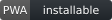
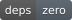
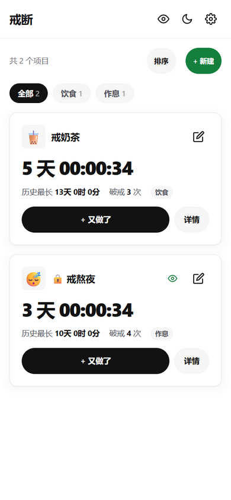
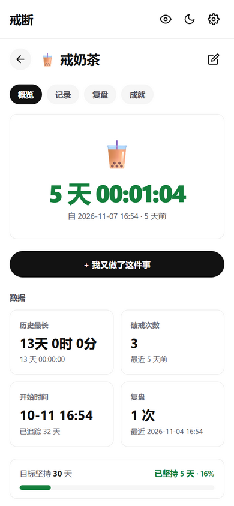
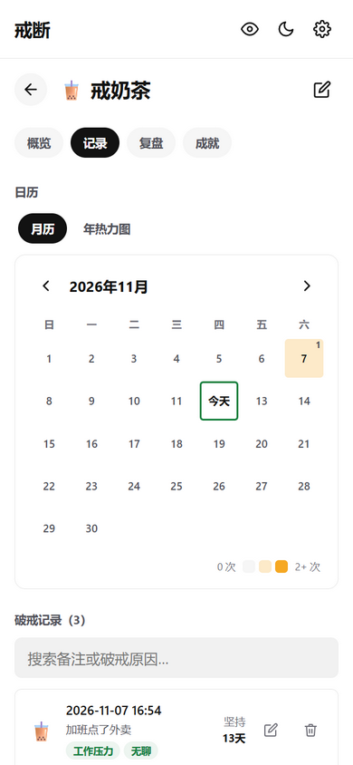
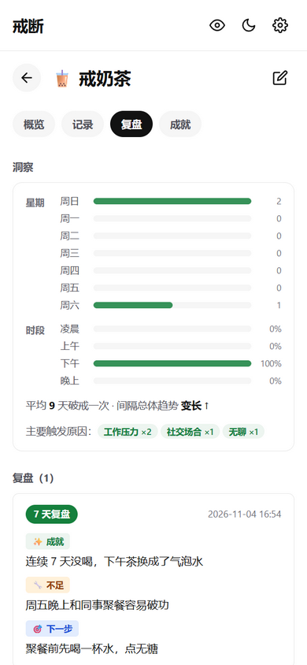

<div align="center">


# 戒断 · 习惯追踪

**把每一次「又做了」都变成数据**

纯本地 · 不登录 · 零依赖的戒断习惯追踪 PWA

<p>
  
  
  
  
  
</p>

[在线使用](https://edward8n25.github.io/habit-quit-tracker/) · [快速开始](#快速开始) · [更新日志](CHANGELOG.md)



<sub>首页 · 浅色主题 · 分类筛选与隐私项目（眼睛图标为睁眼态）</sub>

</div>

---

## ✨ 核心亮点

- **实时计时**：每秒刷新"已坚持 X 天"，打开即见
- **破戒标签 + 模式洞察**：周几、几点、什么场景最容易破戒
- **目标进度 + 12 枚成就徽章**：有终点的坚持更容易完成
- **月历 + 年热力图**：3 档暖色阶随配色配对，一眼看完整年
- **隐私项目 + 对外展示模式**：一键模糊隐藏，演示不露馅
- **数据双 key 冗余**：主备双写、损坏自动回退、JSON 导出导入
- **复盘书写独立视图**：三个文本框均分整屏，周期提醒不打扰
- **四配色 × 深浅主题**：对比度 77 项守门，44px 命中区与键盘焦点全覆盖

## 📸 界面预览

<table>
  <tr>
    <td align="center" width="33%"><br /><sub>详情 · 大计时 + 目标进度</sub></td>
    <td align="center" width="33%"><br /><sub>记录 · 月历 + 破戒历史</sub></td>
    <td align="center" width="33%"><br /><sub>复盘 · 洞察 + 周期复盘</sub></td>
  </tr>
</table>

## 🚀 快速开始

无需安装、无需构建，数据只存在你的浏览器里。

```bash
# 方式一：直接在线使用（可安装为 PWA）
https://edward8n25.github.io/habit-quit-tracker/

# 方式二：本地运行（含 Service Worker 离线能力）
python -m http.server 8765
# 或：.\scripts\dev-server.ps1
```

## 🔒 隐私与数据

- **100% 本地**：所有数据存浏览器 localStorage，不登录、不上传、零外部请求
- **双 key 冗余**：主 key + `.bak` 双写；任一侧损坏自动从另一侧恢复；双损时原始内容另存逃生口
- **可迁移**：JSON 导出 / 导入（合并按 id 去重，覆盖以备份为准）
- **数据自洽**：项目起点独立记录；任何历史版本的数据都走迁移管道，绝不因版本不匹配清空

## 🧪 质量与测试

| 脚本 | 断言 | 覆盖 |
|---|---|---|
| `tests/smoke-test.js` | 120 | 数据层 / 迁移 / 损坏恢复 / 渲染 / 隐私 / 周期统计 / 静态规范 |
| `tests/picker-interaction.js` | 47 | 弹窗挂载后链路、弹窗栈、ESC 脏表单、复盘视图 |
| `tests/contrast-check.js` | 77 | 4 配色 × 2 主题 token 对 + 硬编码语义色 + 亮度对齐 |
| `tests/style-consistency.js` | 8 | 死 CSS / 类名失配 / 间距·圆角·内联 style 棘轮 |
| `tests/assert-sw.js` + `scripts/check-assets.js` | 13 | SW 缓存隔离与版本一致、manifest 图标、资源清单、README 图片 |

全部脚本在 CI 中执行，**失败不部署**；PR 与 main 均跑测试。

## 🧰 技术栈

- **运行形态**：原生 HTML + CSS + JavaScript（ES5 单 IIFE），零依赖、零构建，托管在 GitHub Pages
- **数据层**：localStorage 双 key 冗余 + 版本迁移管道 + 损坏逃生口
- **离线能力**：Service Worker 导航与静态资源 network-first，在线拿最新、离线走缓存
- **质量守门**：6 个零依赖测试脚本，部署前在 CI 强制执行，失败不发布

## 🗺️ 路线

- **快速记录（近期）**：长按项目卡片 1 秒直接记一次破戒，省掉打开弹窗再点确认两步
- **省钱可视化（可选）**：给项目设单次成本，自动折算累计花费与坚持期间省下的钱
- **跨设备同步（可选）**：通过 WebDAV（坚果云）同步备份文件，多台设备共用一份数据

## 📄 License

[MIT](LICENSE) © 2026

---

<details>
<summary>附录：调试入口、本地测试与目录结构</summary>

### 调试入口（URL 参数，仅开发 / 演示用）

| 参数 | 作用 |
|---|---|
| `#seed` | 注入示例项目（无数据时生效，绝不覆盖真实数据） |
| `?detail=<id>` | 直接打开指定项目详情 |
| `?cal=year` | 详情页默认显示年热力图 |
| `?theme=dark` / `?theme=light` | 强制主题（截图用） |
| `?report=<id>` / `?add=<id>` | 自动打开周报 / 记录弹窗（截图用） |
| `?demo=1` | 对外展示模式 |

### 本地测试（需 Node 18+）

```bash
node tests/smoke-test.js
node tests/picker-interaction.js
node tests/contrast-check.js
node tests/style-consistency.js
node tests/assert-sw.js
node scripts/check-assets.js
```

### 目录结构

```
habit-quit-tracker/
├── index.html            # 入口：HTML + 全部内联 CSS
├── src/app.js            # 全部业务逻辑（单 IIFE）
├── sw.js                 # Service Worker
├── manifest.json         # PWA 清单
├── assets/icons/         # 图标三件套
├── docs/screenshots/     # README 截图
├── docs/badges/          # README 徽章（本地 SVG）
├── tests/                # 6 个零依赖测试
├── scripts/              # 资源校验 / 本地服务器 / 图标生成
└── .github/workflows/    # CI：测试通过才部署
```

</details>
